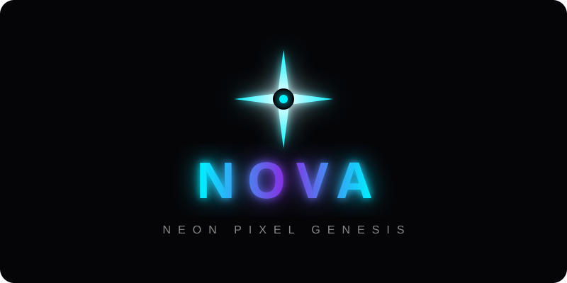

<!-- =============================================
     NOVA — Neon Pixel Genesis
     README.md
     ============================================= -->

<div align="center">
  
  <br/>
  <h3>خاستگاه پیکسل‌ها — تبدیل عکس به هنر دیجیتال با ۱۰ حالت خلق تصویر</h3>
  <p>یک وب‌اپلیکیشن هنری و سایبرپانک که تصاویر شما را پیکسل به پیکسل از دل تاریکی خلق می‌کند.</p>
</div>

<p align="center">
  <a href="https://sajadshahimn.github.io/NOVA/">
    
  </a>
  <a href="https://github.com/sajadshahimn/NOVA">
    
  </a>
</p>

<p align="center">
  
  
  
  
  
</p>

<p align="center">
  
  
  
  
</p>

---

<div dir="rtl">

## 🌌 درباره پروژه

**NOVA** یک وب‌اپلیکیشن هنری است که عکس شما را می‌گیرد و آن را **پیکسل به پیکسل** از دل تاریکی خلق می‌کند. تصویر در نهایت با یک **امضای لیزری NOVA** در گوشه‌ی آن به یک اثر هنری نئونی تبدیل می‌شود که می‌توانید ویدیوی آن را دانلود کنید.

تمام پردازش‌ها **درون مرورگر** (Client-Side) انجام می‌شود. هیچ تصویری آپلود نمی‌شود و هیچ سروری نیاز نیست. پروژه کاملاً **دوزبانه (فارسی / انگلیسی)** است و برای **تمام دستگاه‌ها** (موبایل، تبلت و دسکتاپ) بهینه‌سازی شده است.

---

## ✨ ویژگی‌های کلیدی

| ویژگی | توضیح |
|--------|-------|
| 🎨 **۱۰ حالت خلق تصویر** | Spectrum، Thermal، Luminous، Clusters، RGB Split، Edge & Fill، Radar، Matrix، Secret |
| 🌐 **پشتیبانی دو زبانه** | رابط کاربری کامل فارسی و انگلیسی با تغییر خودکار جهت صفحه (RTL/LTR) |
| 🔒 **مود مخفی** | فقط پس از اجرای هر ۸ مود عادی باز می‌شود (دستاورد) |
| 💻 **مود ماتریکس (Matrix)** | خلق تصویر با کاراکترهای `0` و `1` برای حس هکری و سایبرپانک |
| 🖋️ **امضای لیزری NOVA** | حکاکی نئونی کلمه NOVA در گوشه‌ی تصویر در پایان کار |
| 🎵 **موسیقی سینتی‌سایزر زنده** | تولید موسیقی Ambient Sci-Fi توسط Web Audio API (بدون فایل MP3) |
| 🔊 **افکت‌های صوتی** | صدای کلیک، موفقیت، و لیزر همگام با انیمیشن |
| 🎚️ **کنترل سرعت** | اسلایدر برای تنظیم سرعت انیمیشن (آهسته / عادی / سریع) |
| 🎲 **دکمه شانس** | انتخاب تصادفی یکی از مودها و شروع خودکار |
| 📷 **پشتیبانی از وب‌کم** | گرفتن عکس مستقیم با دوربین گوشی یا لپ‌تاپ |
| 🖼️ **حذف پس‌زمینه تیره** | حذف خودکار پیکسل‌های بسیار تیره برای برجسته‌تر شدن سوژه |
| 📺 **افکت CRT** | خطوط اسکن مانیتورهای قدیمی برای حس سایبرپانک |
| 🎨 **پالت رنگی** | نمایش ۵ رنگ اصلی تصویر در پایان کار |
| 🔍 **اسلایدر مقایسه** | مقایسه‌ی عکس اصلی با شاهکار ساخته شده |
| 💾 **خروجی‌های متنوع** | دانلود ویدیو (WebM با صدا)، عکس PNG، و کارت اشتراک‌گذاری استوری |
| 🖼️ **گالری محلی** | ذخیره‌ی ۱۰ شاهکار آخر در حافظه‌ی مرورگر (LocalStorage) |
| 📱 **کاملاً ریسپانسیو** | بهینه‌سازی شده برای موبایل، تبلت و دسکتاپ با تنظیم خودکار رزولوشن |

---

## 🎬 دمو آنلاین

<p align="center">
  <a href="https://sajadshahimn.github.io/NOVA/">
    
  </a>
</p>

> **نکته:** برای بهترین تجربه، از مرورگر Chrome یا Edge استفاده کنید. پروژه به طور کامل روی GitHub Pages میزبانی شده است.

---

## 🚀 شروع سریع (نصب محلی)

۱. مخزن را کلون کنید:
```bash
git clone https://github.com/sajadshahimn/NOVA.git
cd NOVA
